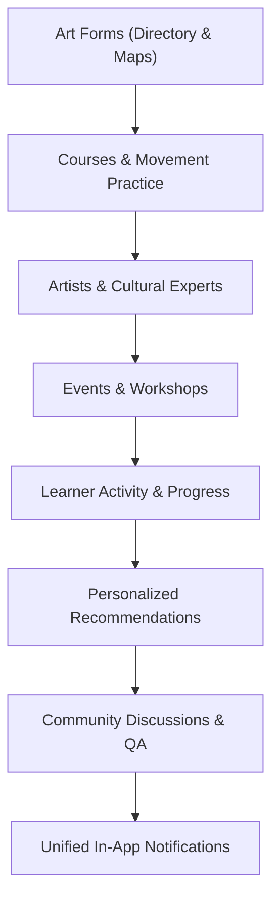
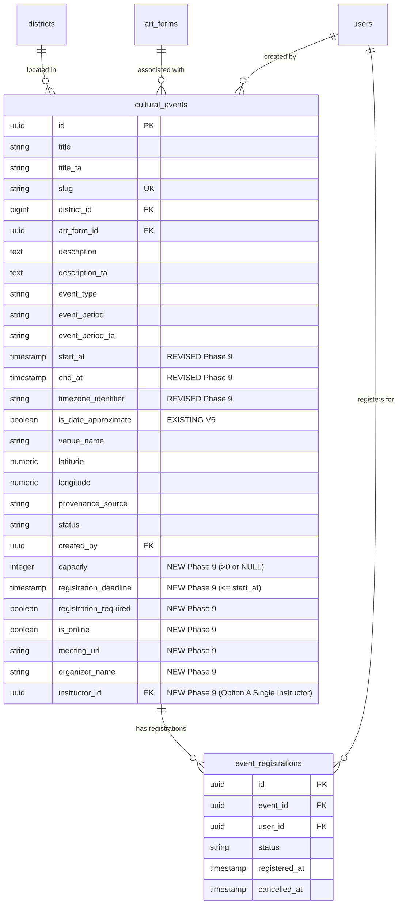
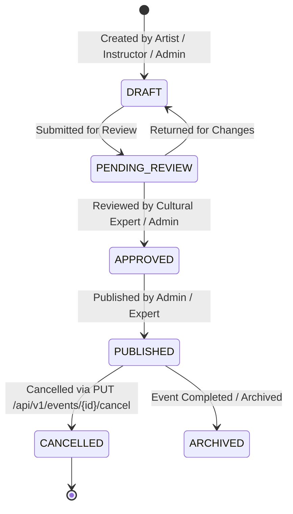
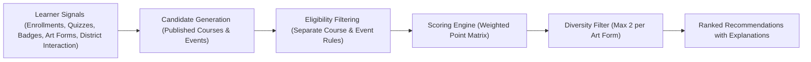
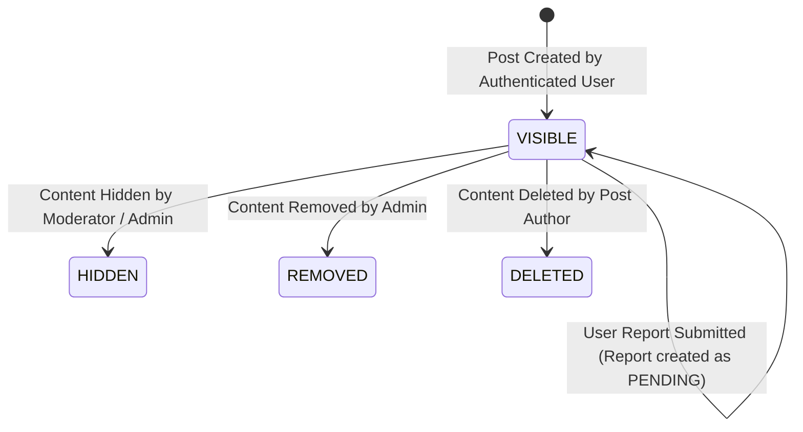
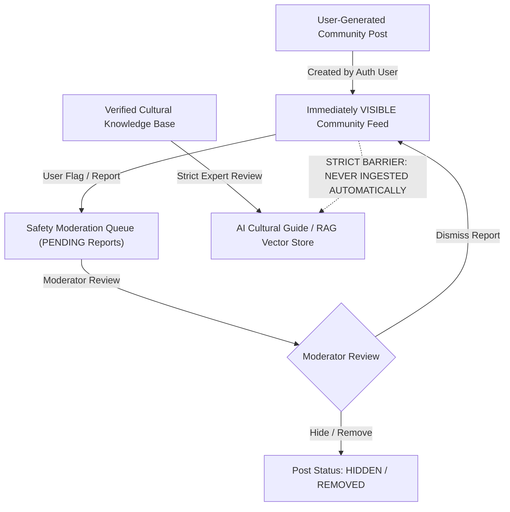

# PHASE 9 — TECHNICAL IMPLEMENTATION PLAN
## Events, Recommendations & Community

**STATUS: REVISED PROPOSED PLAN — PENDING FINAL APPROVAL**

> [!IMPORTANT]
> **PLANNING ONLY.** No source code or database changes have been made in this step. Implementation will begin only after explicit user approval of this technical document.

---

## 1. Executive Summary & Scope Boundary

Phase 9 transforms Marabagam into an interconnected cultural ecosystem by linking learners, art forms, courses, cultural events, community discussions, personalized recommendations, and unified notifications.



### In-Scope vs. Out-of-Scope Boundary

| In-Scope (Phase 9 MVP) | Out-of-Scope (Deferred / Prohibited) |
|---|---|
| **Cultural Events & Workshops**: Discovery, filtering, detail views, governance lifecycle (`DRAFT` → `PUBLISHED`). | **Payment Processing / E-Commerce**: Ticket sales or paid event registration. All MVP events are free/open registration. |
| **Event Registration**: Free registration tracking, capacity limits, voluntary cancellation, deadline enforcement, single active registration per user. | **Live Streaming Infrastructure**: WebRTC video servers or live broadcast hosting. External meeting links (HTTPS only) used for online events. |
| **Explainable Recommendation Engine**: Content-based deterministic scoring algorithm based on learning activity, explored art forms, and district interests. | **Complex Black-Box ML Recommenders**: Collaborative filtering or opaque neural embeddings. Recommendation notifications removed for MVP. |
| **Moderated Community Discussions**: Categorized plain-text discussions (`DISCUSSION`, `QUESTION`, `LEARNING_JOURNEY`, `EVENT_DISCUSSION`, `ART_FORM_DISCUSSION`), single-depth comments, author ownership. | **Direct Messaging & Voice/Video Calls**: Peer-to-peer messaging or chat channels. |
| **Content Moderation & Abuse Reporting**: Flagging posts/comments, moderation queue, moderator actions (`HIDE`, `REMOVE`, `DISMISS`), audit logging. | **Generic Social Media Feed**: Unmoderated global chatter, rich HTML rendering, or unrestricted multimedia sharing. |
| **Unified Notification System**: In-app unread counter, notification drawer, preference controls, deduplication `UNIQUE(recipient_id, deduplication_key)` & Spring scheduled reminders. | **External Email / SMS / Mobile Push Infrastructure**: External delivery services deferred for MVP. |
| **PostgreSQL & Spatial Search Enhancements**: Full-text and district-based discovery for events and community. | **Elasticsearch / OpenSearch**: Additional search cluster deployment deferred unless scale demands it. |

---

## 2. Existing Architecture Inspection & Reuse

Before defining new components, the current repository was inspected to maximize reuse:

1. **Authentication & RBAC**: Reuse `SecurityConfig`, JWT authentication filters, and user roles (`GUEST`, `LEARNER`, `ARTIST`, `INSTRUCTOR`, `CULTURAL_EXPERT`, `ADMIN`).
2. **Database Entities**:
   - `cultural_events` (created in `V6__regional_heritage_mapping.sql`) will be **extended** via Flyway `V9__events_recommendations_community.sql` rather than creating a duplicate table.
   - Reusing `User`, `ArtForm`, `Course`, `Lesson`, `Enrollment`, `LessonProgress`, `District`, `Badge`, `UserStreak`.
3. **Audit Logging**: Reusing `@Auditable` annotation and `AuditAspect` for event governance, registration events, community post/comment reporting, and moderation actions.
4. **Rate Limiting**: Reusing `RateLimitingFilter` to protect post creation, comment submission, reporting endpoints, and notification polling against spam.
5. **Localization & A11y**: Reusing `en.json` & `ta.json` translation dictionaries and standard accessible layout components (`AppShell`, `Header`).

### Mandatory Pre-Implementation Checklist (REQ-4)

Before ANY V9 source code modification, Java/TypeScript file creation, or Flyway V9 execution begins, the developer MUST execute the following pre-implementation inspection against the codebase and database:

- [x] **Inspect V6 Migration File**: Thoroughly reviewed `V6__regional_heritage_mapping.sql`. Confirmed `cultural_events.is_date_approximate BOOLEAN NOT NULL DEFAULT TRUE` ALREADY exists in V6. V9 reuses this column and will NOT attempt to add it again.
- [ ] **Inspect Live `cultural_events` Table**: Inspect current table columns, foreign keys, and default constraints in PostgreSQL.
- [ ] **Inspect Existing Event Records**: Check existing data rows in `cultural_events` for current `status` values and date semantics (`start_date`, `end_date`, `event_period`).
- [ ] **Inspect Date & Timestamp Semantics**: Verify how existing Phase 6 records handle exact vs. approximate dates.
- [ ] **Inspect Existing Indexes & Constraints**: Check existing database indexes on `cultural_events` to ensure V9 `ALTER TABLE` statements perform cleanly without conflicts.
- [ ] **Verify V9 Schema ALTER Compatibility**: Validate that proposed `ALTER TABLE cultural_events ADD COLUMN IF NOT EXISTS ...` queries are fully compatible with V6.
- [ ] **Verify Phase 1–8 Test Suite**: Confirm all existing Phase 1–8 unit and integration tests remain passing before Phase 9 execution.
- [ ] **Confirm Zero Premature Execution**: Confirm that no V9 Java/TypeScript code or Flyway migration is created until explicit final approval.

---

## 3. Cultural Events & Workshops Architecture

### Entity Schema & Migration Strategy (Extending `cultural_events`)

Phase 6 (`V6__regional_heritage_mapping.sql`) established the `cultural_events` table. Phase 9 extends this table to support exact timestamps, workshops, and learner registrations without breaking previous functionality.



### Event Temporal Model & Integrity Validations

#### 1. Temporal Integrity (`start_at` & `end_at`)
- **Exact Timestamps**: `start_at TIMESTAMP WITH TIME ZONE` and `end_at TIMESTAMP WITH TIME ZONE`.
- **End Time Constraint**: Whenever both `start_at` and `end_at` are specified, `end_at` MUST be strictly greater than `start_at` (`end_at > start_at`).
- **Database & Application Enforcement**:
  - DB Constraint: `CONSTRAINT chk_event_end_after_start CHECK (end_at IS NULL OR start_at IS NULL OR end_at > start_at)`
  - Application Validation: In `EventService` and request DTOs, if `start_at != null && end_at != null && !end_at.isAfter(start_at)`, throw validation error resulting in HTTP `400 BAD_REQUEST` ("End time must be after start time").

#### 2. Capacity & Deadline Integrity
- **Capacity Values**: `capacity` must be `NULL` (unlimited) or strictly greater than zero (`capacity > 0`). Zero (`0`) and negative capacities are **explicitly rejected**.
  - DB Constraint: `CONSTRAINT chk_event_capacity_positive CHECK (capacity IS NULL OR capacity > 0)`
  - Application Validation: DTO `@Min(value = 1, message = "Capacity must be greater than zero if specified")` returns HTTP `400 BAD_REQUEST` on zero or negative values.
- **Registration Deadline**: If `registration_deadline` is specified for an exact event with `start_at`, `registration_deadline` must NOT be after `start_at` (`registration_deadline <= start_at`).
  - DB Constraint: `CONSTRAINT chk_event_reg_deadline CHECK (registration_deadline IS NULL OR start_at IS NULL OR registration_deadline <= start_at)`
  - Application Validation: Rejects invalid deadlines with HTTP `400 BAD_REQUEST` ("Registration deadline cannot be after event start time").
- **Registration Required Constraint**: If `capacity > 0`, `registration_required` MUST be `TRUE`. Incompatible combinations return HTTP `400 BAD_REQUEST`.

#### 3. Strict Timezone Validation
- **Validation**: `timezone_identifier` must be validated against supported Java `ZoneId.getAvailableZoneIds()` (e.g. `ZoneId.of(identifier)`).
- **Free-Form Text Rejection**: `timezone_identifier` is **NOT** treated as arbitrary free-form text. Unrecognized timezone strings (e.g. `"Invalid/Zone"`, `"UTC+99"`, free text) are rejected with HTTP `400 BAD_REQUEST` ("Invalid timezone identifier").
- **Default Timezone**: Preserves `'Asia/Kolkata'` as default.

#### 4. V6 `is_date_approximate` Schema Resolution
- **Inspection Finding**: `cultural_events.is_date_approximate BOOLEAN NOT NULL DEFAULT TRUE` ALREADY exists in `V6__regional_heritage_mapping.sql`.
- **Flyway V9 Strategy**: V9 reuses `is_date_approximate` from V6 and does **NOT** attempt to add it again via `ALTER TABLE`.
- **Mandatory V6 Data Strategy**:
  - `start_at`/`end_at` backfilled ONLY where existing V6 data supports exact timestamps.
  - For seasonal/approximate events, `is_date_approximate` is set to `TRUE`, and `event_period` / `event_period_ta` remain primary cultural date descriptors.
  - Old `start_date` / `end_date` columns are retained for backwards compatibility, marked as deprecated.
  - Public search queries evaluate: `WHERE status = 'PUBLISHED' AND (start_at >= CURRENT_TIMESTAMP OR start_at IS NULL OR is_date_approximate = TRUE)`.

### Event Ownership & RBAC Security (IDOR Defense)
- **Artist / Instructor Ownership**: Artists and Instructors can edit (`PUT /api/v1/events/{id}`) and submit (`PUT /api/v1/events/{id}/submit`) **ONLY** events that they created (`created_by == currentUser.id`). Attempting to edit or submit another user's event is blocked server-side with HTTP `403 FORBIDDEN` ("You are not authorized to modify this event").
- **Cultural Expert / Admin Governance**: Cultural Experts and Admins perform governance operations (`approve`, `publish`, `cancel`) across all events according to policy. Self-approval remains strictly blocked (`CHECK (approved_by <> created_by)`).

### Event Location Privacy & Meeting Link Security
- **Public Venues & Institutions**: Full precise latitude/longitude coordinates (5 decimal places, ~1 meter precision).
- **Private Residences / Personal Addresses**: Coordinate precision truncated to 2 decimal places (~1.1 km area bounding box) and `venue_name` labeled as "Private Workshop Venue (Details provided upon registration)".
- **Meeting URL Security**: `meeting_url` must be `HTTPS` scheme only, syntax-validated, rejecting `javascript:`, `data:`, and `http:`. `meeting_url` is exposed ONLY to authenticated registered users for private online events.

### Event Capacity Semantics
- `capacity IS NULL` & `registration_required = FALSE` $\rightarrow$ Open/unlimited public event.
- `capacity > 0` & `registration_required = TRUE` $\rightarrow$ Limited capacity event.
- Server validates that `capacity > 0` requires `registration_required = TRUE` (rejects invalid configurations with `400 BAD_REQUEST`).

### Content Governance & Lifecycle



- **Self-Approval Prohibition**: Enforced by check constraint `CHECK (approved_by IS NULL OR approved_by <> created_by)`.
- **Public Isolation**: Public event APIs return ONLY `PUBLISHED` events.
- **Editing Rules (`PUT /api/v1/events/{id}`)**:
  - `DRAFT`: Creator can edit freely.
  - `PUBLISHED`: Editing sensitive fields (`start_at`, `end_at`, `venue_name`, `instructor_id`, `description`) automatically resets status to `PENDING_REVIEW` for re-review.
- **Cancellation (`PUT /api/v1/events/{id}/cancel`)**:
  - Authorized for Event Creator or `ADMIN`.
  - Updates status to `CANCELLED`, rejects new registrations, preserves registration history, triggers cancellation notifications to registered attendees, and records audit log.

---

## 4. Event Registration System (Revised Partial Unique Index)

- **Registration History & Single Active Registration**:
  To allow a learner to register, cancel, and re-register without violating unique constraints, registration history is preserved while single active registration is enforced using a PostgreSQL partial unique index:
  ```sql
  CREATE UNIQUE INDEX idx_uk_active_event_registration 
  ON event_registrations (event_id, user_id) 
  WHERE status = 'REGISTERED';
  ```
- **Lifecycle Support**: `REGISTERED` $\rightarrow$ `CANCELLED` $\rightarrow$ `REGISTERED`.
- **Capacity & Deadline Enforcement**: Server-side registration checks use pessimistic row locking (`SELECT FOR UPDATE`) on `cultural_events` to verify `count(active_registrations) < capacity` and current UTC timestamp $\le$ `registration_deadline`.
- **Role Policy**: Open to all authenticated active roles (`LEARNER`, `ARTIST`, `INSTRUCTOR`, `CULTURAL_EXPERT`, `ADMIN`).
- **Attendance**: `ATTENDED` status removed from Phase 9 MVP (deferred to future check-in phase). Valid MVP statuses: `REGISTERED`, `CANCELLED`.
- **Add-to-Calendar**: Client-side dynamic `.ics` iCalendar file export generated from event metadata. No external calendar APIs required.

---

## 5. Personalized Recommendation Engine Architecture

### Algorithm Design (Explainable Content-Based MVP)
Operates deterministically using explicit learner signals rather than opaque black-box models.



### Recommendation Scoring & Normalization
Scores are calculated as raw internal weighted points:

$$\text{RelevanceScore}(Item, User) = S_{\text{art\_form}} + S_{\text{difficulty}} + S_{\text{district}} + S_{\text{freshness}} + S_{\text{popularity}}$$

- $S_{\text{art\_form}} = +40$ points if item's Art Form matches an Art Form where user has completed courses, passed quizzes, or earned badges.
- $S_{\text{difficulty}} = +20$ points if course difficulty matches user's current progression level.
- $S_{\text{district}} = +15$ points if item matches districts where user has registered for events or explored heritage maps (**cultural-learning interaction only; NO residential location profiling**).
- $S_{\text{freshness}} = +15 \cdot \max\left(0, 1 - \frac{\text{days\_since\_published}}{30}\right)$ points.
- $S_{\text{popularity}} = +10 \cdot \min\left(1.0, \frac{\text{aggregate\_enrollments}}{100}\right)$ points (**aggregate counts only; NO individual activity leakage**).

*Note*: Raw numerical scores remain internal to the backend; the API returns item rank, payload, and bilingual explanation string.

### Separate Item Eligibility
- **Courses**: Active enrollments excluded from "new course" recommendations; completed courses deprioritized; related advanced courses recommended.
- **Events**: Upcoming, `PUBLISHED`, registration-eligible events only.
- **Art Forms**: Unexplored related art forms recommended for discovery.

### Cold Start Strategy
For new learners without prior learning history:
- Top published introductory courses ranked by aggregate enrollment.
- Upcoming published cultural events.
- Labeled as "Featured Cultural Content" / "சிறப்புப் பாரம்பரிய உள்ளடக்கங்கள்".

### Diversity Constraint & Notifications
- Maximum 2 consecutive items from the same Art Form.
- **Recommendation Notifications**: REMOVED from Phase 9 MVP. Recommendations appear inside dashboard and recommendations page ONLY.

---

## 6. Moderated Community & Discussion System

### Content Format & Plain-Text Security
- **Post Categories**: `DISCUSSION`, `QUESTION`, `LEARNING_JOURNEY`, `EVENT_DISCUSSION`, `ART_FORM_DISCUSSION`.
- **Plain-Text Formatting**: User-generated content is rendered strictly as plain text (or escaped markdown) to eliminate XSS, HTML injection, and sanitizer bypass risks. Max post content: 2,000 chars; Max comment content: 500 chars.

### Comment Threading (Flat 2-Tier Model)
To avoid deeply recursive queries, comment nesting is restricted to **maximum 1 reply level** (`parent_comment_id` must point to a top-level comment where `parent_comment_id IS NULL`).

### Community Access & Author Identity
- **Public**: Read visible community posts & comments.
- **Authenticated**: Create posts, comment, report content. Anonymous users cannot write/report.
- **Privacy**: Public DTO exposes ONLY `authorDisplayName`, `authorRole`, and `authorAvatarUrl`. Never exposes email, internal UUIDs, or learning history.

### Moderation Lifecycle & Reporting System (REQ-2 & REQ-3)

Phase 9 community posts and comments are **USER-GENERATED CONTENT (UGC)** created by authenticated users. Posts are **immediately `VISIBLE`** upon creation and do **NOT** require Cultural Expert or moderator approval before appearing in the community feed.



- **Post Statuses**: `VISIBLE`, `HIDDEN`, `REMOVED`, `DELETED`.
- **Report Statuses**: `PENDING`, `DISMISSED`, `ACTIONED`.
- **Report Handling (NO Arbitrary Thresholds)**:
  - When a user flags a post or comment, a report is recorded in `community_reports` with status `PENDING`.
  - **No Automatic Hiding / State Change**: A report does NOT automatically change the post's public state or hide it, regardless of report count. The post remains `VISIBLE` while reports are `PENDING`.
  - **Moderator Queue Review**: Moderators review the pending reports queue:
    - **Dismiss**: If the report is invalid or false, moderator marks report as `DISMISSED`. Post remains `VISIBLE`.
    - **Action**: If content violates policy, moderator updates post status to `HIDDEN` or `REMOVED`, and marks report as `ACTIONED`.
- **Reporting Rules**: `community_reports` table enforces `UNIQUE(reporter_id, target_type, target_id)`. Self-reporting is blocked (`reporter_id == author_id`). Server validates polymorphic targets (`target_type = 'POST'` $\rightarrow$ `community_posts`; `target_type = 'COMMENT'` $\rightarrow$ `community_comments`). Rate limited to max 5 reports per user per hour.
- **Deletion Semantics**: User deletion sets `status = 'DELETED'`, `deleted_at`, `deleted_by`. Public APIs omit `DELETED`, `HIDDEN`, and `REMOVED` content entirely.

---

## 7. Unified Notification System

### Recipient-Scoped Deduplication Model (REVISED)
To prevent cross-user collisions when 100 learners receive the same event reminder, deduplication is scoped to the recipient:

```sql
CONSTRAINT uk_recipient_deduplication UNIQUE (recipient_id, deduplication_key)
```

- **Example**: `recipient_id = USER123`, `deduplication_key = EVENT_REMINDER|EVENT456|2026-09-10`.

### Trigger Events & Preference Control

| Notification Type | Preference Category | Configurable? | Trigger Mechanism |
|---|---|:---:|---|
| `EVENT_REMINDER` | `events_enabled` | Yes | Spring `@Scheduled` job (every 15 mins) checking events starting in 24 hours. |
| `EVENT_CANCELLED` | `events_enabled` | Yes | Event cancellation execution. |
| `BADGE_EARNED` | `achievements_enabled` | Yes | Gamification engine badge award. |
| `CERTIFICATE_ISSUED` | `achievements_enabled` | Yes | Certificate generation execution. |
| `COMMUNITY_REPLY` | `community_enabled` | Yes | New comment on user's post (10-min cooldown window per thread). |
| `MODERATION_UPDATE` | Always Enabled | No | Outcome of user-submitted content report. |
| `ACCOUNT_SECURITY` | Always Enabled | No | Critical security / password alerts. |

*Note*: `recommendations_enabled` removed from preferences & MVP.

### Spring Scheduled Job Specification (`EventReminderScheduler`)
- **Frequency**: Every 15 minutes (`0 */15 * * * *`).
- **Reminder Window**: Finds active event registrations for events starting in `[now + 23.75h, now + 24.25h]`.
- **Idempotency**: `UNIQUE(recipient_id, deduplication_key)` prevents double alerts.

---

## 8. Database Schema Design (Proposed V9 Migration)

Proposed migration script: `backend/src/main/resources/db/migration/V9__events_recommendations_community.sql`

```sql
-- 1. Extend cultural_events table (created in V6)
-- Note: is_date_approximate ALREADY exists in V6 and is NOT re-added here.
ALTER TABLE cultural_events
    ADD COLUMN IF NOT EXISTS capacity INTEGER,
    ADD COLUMN IF NOT EXISTS registration_deadline TIMESTAMP WITH TIME ZONE,
    ADD COLUMN IF NOT EXISTS registration_required BOOLEAN NOT NULL DEFAULT FALSE,
    ADD COLUMN IF NOT EXISTS is_online BOOLEAN NOT NULL DEFAULT FALSE,
    ADD COLUMN IF NOT EXISTS meeting_url VARCHAR(500),
    ADD COLUMN IF NOT EXISTS organizer_name VARCHAR(200),
    ADD COLUMN IF NOT EXISTS instructor_id UUID REFERENCES users(id) ON DELETE SET NULL,
    ADD COLUMN IF NOT EXISTS start_at TIMESTAMP WITH TIME ZONE,
    ADD COLUMN IF NOT EXISTS end_at TIMESTAMP WITH TIME ZONE,
    ADD COLUMN IF NOT EXISTS timezone_identifier VARCHAR(50) DEFAULT 'Asia/Kolkata',
    ADD CONSTRAINT chk_event_end_after_start CHECK (end_at IS NULL OR start_at IS NULL OR end_at > start_at),
    ADD CONSTRAINT chk_event_capacity_positive CHECK (capacity IS NULL OR capacity > 0),
    ADD CONSTRAINT chk_event_reg_deadline CHECK (registration_deadline IS NULL OR start_at IS NULL OR registration_deadline <= start_at);

-- 2. Create Table: event_registrations
CREATE TABLE IF NOT EXISTS event_registrations (
    id UUID PRIMARY KEY DEFAULT gen_random_uuid(),
    event_id UUID NOT NULL REFERENCES cultural_events(id) ON DELETE CASCADE,
    user_id UUID NOT NULL REFERENCES users(id) ON DELETE CASCADE,
    status VARCHAR(50) NOT NULL DEFAULT 'REGISTERED', -- 'REGISTERED', 'CANCELLED'
    registered_at TIMESTAMP WITH TIME ZONE DEFAULT CURRENT_TIMESTAMP NOT NULL,
    cancelled_at TIMESTAMP WITH TIME ZONE
);

-- Partial Unique Index allowing history while enforcing single active registration
CREATE UNIQUE INDEX IF NOT EXISTS idx_uk_active_event_registration 
ON event_registrations (event_id, user_id) 
WHERE status = 'REGISTERED';

-- 3. Create Table: community_posts
CREATE TABLE IF NOT EXISTS community_posts (
    id UUID PRIMARY KEY DEFAULT gen_random_uuid(),
    author_id UUID REFERENCES users(id) ON DELETE SET NULL,
    art_form_id UUID REFERENCES art_forms(id) ON DELETE SET NULL,
    category VARCHAR(50) NOT NULL DEFAULT 'DISCUSSION', -- 'DISCUSSION', 'QUESTION', 'LEARNING_JOURNEY', 'EVENT_DISCUSSION', 'ART_FORM_DISCUSSION'
    title VARCHAR(200) NOT NULL,
    content TEXT NOT NULL,
    status VARCHAR(50) NOT NULL DEFAULT 'VISIBLE', -- 'VISIBLE', 'HIDDEN', 'REMOVED', 'DELETED'
    created_at TIMESTAMP WITH TIME ZONE DEFAULT CURRENT_TIMESTAMP NOT NULL,
    updated_at TIMESTAMP WITH TIME ZONE DEFAULT CURRENT_TIMESTAMP NOT NULL,
    deleted_at TIMESTAMP WITH TIME ZONE,
    deleted_by UUID REFERENCES users(id) ON DELETE SET NULL
);

-- 4. Create Table: community_comments
CREATE TABLE IF NOT EXISTS community_comments (
    id UUID PRIMARY KEY DEFAULT gen_random_uuid(),
    post_id UUID NOT NULL REFERENCES community_posts(id) ON DELETE CASCADE,
    author_id UUID REFERENCES users(id) ON DELETE SET NULL,
    parent_comment_id UUID REFERENCES community_comments(id) ON DELETE CASCADE,
    content TEXT NOT NULL,
    status VARCHAR(50) NOT NULL DEFAULT 'VISIBLE', -- 'VISIBLE', 'HIDDEN', 'REMOVED', 'DELETED'
    created_at TIMESTAMP WITH TIME ZONE DEFAULT CURRENT_TIMESTAMP NOT NULL,
    updated_at TIMESTAMP WITH TIME ZONE DEFAULT CURRENT_TIMESTAMP NOT NULL,
    deleted_at TIMESTAMP WITH TIME ZONE,
    deleted_by UUID REFERENCES users(id) ON DELETE SET NULL
);

-- 5. Create Table: community_reports
CREATE TABLE IF NOT EXISTS community_reports (
    id UUID PRIMARY KEY DEFAULT gen_random_uuid(),
    reporter_id UUID NOT NULL REFERENCES users(id) ON DELETE CASCADE,
    target_type VARCHAR(50) NOT NULL, -- 'POST', 'COMMENT'
    target_id UUID NOT NULL,
    reason VARCHAR(100) NOT NULL,
    description TEXT,
    status VARCHAR(50) NOT NULL DEFAULT 'PENDING', -- 'PENDING', 'DISMISSED', 'ACTIONED'
    reviewed_by UUID REFERENCES users(id) ON DELETE SET NULL,
    reviewed_at TIMESTAMP WITH TIME ZONE,
    created_at TIMESTAMP WITH TIME ZONE DEFAULT CURRENT_TIMESTAMP NOT NULL,
    CONSTRAINT uk_reporter_target UNIQUE (reporter_id, target_type, target_id)
);

-- 6. Create Table: notifications
CREATE TABLE IF NOT EXISTS notifications (
    id UUID PRIMARY KEY DEFAULT gen_random_uuid(),
    recipient_id UUID NOT NULL REFERENCES users(id) ON DELETE CASCADE,
    notification_type VARCHAR(50) NOT NULL,
    title VARCHAR(200) NOT NULL,
    title_ta VARCHAR(200) NOT NULL,
    message TEXT NOT NULL,
    message_ta TEXT NOT NULL,
    is_read BOOLEAN NOT NULL DEFAULT FALSE,
    deduplication_key VARCHAR(255),
    related_entity_type VARCHAR(50),
    related_entity_id UUID,
    created_at TIMESTAMP WITH TIME ZONE DEFAULT CURRENT_TIMESTAMP NOT NULL,
    CONSTRAINT uk_recipient_deduplication UNIQUE (recipient_id, deduplication_key)
);

-- 7. Create Table: notification_preferences
CREATE TABLE IF NOT EXISTS notification_preferences (
    user_id UUID PRIMARY KEY REFERENCES users(id) ON DELETE CASCADE,
    events_enabled BOOLEAN NOT NULL DEFAULT TRUE,
    community_enabled BOOLEAN NOT NULL DEFAULT TRUE,
    achievements_enabled BOOLEAN NOT NULL DEFAULT TRUE,
    updated_at TIMESTAMP WITH TIME ZONE DEFAULT CURRENT_TIMESTAMP NOT NULL
);

-- 8. Performance Indexes
CREATE INDEX IF NOT EXISTS idx_cultural_events_status_start ON cultural_events(status, start_at);
CREATE INDEX IF NOT EXISTS idx_cultural_events_district_status ON cultural_events(district_id, status);
CREATE INDEX IF NOT EXISTS idx_cultural_events_artform_status ON cultural_events(art_form_id, status);
CREATE INDEX IF NOT EXISTS idx_event_reg_event_status ON event_registrations(event_id, status);
CREATE INDEX IF NOT EXISTS idx_event_reg_user_status ON event_registrations(user_id, status);
CREATE INDEX IF NOT EXISTS idx_posts_status_created ON community_posts(status, created_at DESC);
CREATE INDEX IF NOT EXISTS idx_posts_artform_status ON community_posts(art_form_id, status);
CREATE INDEX IF NOT EXISTS idx_comments_post_status ON community_comments(post_id, status, created_at ASC);
CREATE INDEX IF NOT EXISTS idx_notifications_recipient_read ON notifications(recipient_id, is_read, created_at DESC);
CREATE INDEX IF NOT EXISTS idx_reports_status_created ON community_reports(status, created_at ASC);
```

---

## 9. API Specifications

### Cultural Events APIs
- `GET /api/v1/events` (Public: Filter by district, art form, date range, type. Returns PUBLISHED only).
- `GET /api/v1/events/{slug}` (Public: Event detail view. Private meeting link exposed ONLY to registered users).
- `POST /api/v1/events` (Auth Contributor: Create draft event).
- `PUT /api/v1/events/{id}` (Auth Contributor: Edit event draft; sensitivity checks apply).
- `PUT /api/v1/events/{id}/submit` (Auth Contributor: Submit event for review).
- `PUT /api/v1/events/{id}/approve` (Cultural Expert/Admin: Approve event; self-approval blocked).
- `PUT /api/v1/events/{id}/publish` (Admin/Expert: Publish approved event).
- `PUT /api/v1/events/{id}/cancel` (Organizer/Admin: Cancel published event and notify attendees).
- `POST /api/v1/events/{id}/register` (Auth User: Register for event).
- `DELETE /api/v1/events/{id}/register` (Auth User: Cancel event registration).
- `GET /api/v1/events/my-registrations` (Auth User: List registered events).

### Recommendation APIs
- `GET /api/v1/recommendations` (Auth Learner: Get personalized recommendation feed with explanations).

### Community APIs
- `GET /api/v1/community/posts` (Public: Get visible community posts with pagination).
- `GET /api/v1/community/posts/{id}` (Public: Get post detail and 2-tier comments).
- `POST /api/v1/community/posts` (Auth User: Create plain-text community post).
- `PUT /api/v1/community/posts/{id}` (Auth Author: Edit post within 15-min window).
- `DELETE /api/v1/community/posts/{id}` (Auth Author: Delete own post).
- `POST /api/v1/community/posts/{id}/comments` (Auth User: Add comment to post).
- `DELETE /api/v1/community/comments/{id}` (Auth Author: Delete own comment).
- `POST /api/v1/community/reports` (Auth User: Submit report for post or comment).
- `GET /api/v1/admin/community/reports` (Cultural Expert/Admin: Get moderation queue).
- `PUT /api/v1/admin/community/reports/{id}/action` (Cultural Expert/Admin: Action report e.g. HIDE/REMOVE/DISMISS).

### Notification APIs
- `GET /api/v1/notifications` (Auth User: Get notifications with unread count).
- `PUT /api/v1/notifications/{id}/read` (Auth User: Mark notification as read).
- `PUT /api/v1/notifications/read-all` (Auth User: Mark all as read).
- `GET /api/v1/notifications/preferences` (Auth User: Get preferences).
- `PUT /api/v1/notifications/preferences` (Auth User: Update preferences).

---

## 10. Frontend Architecture & UI Layout Plans

### React Routes & Page Structure
- `/events`: Event discovery directory with calendar/grid toggle, district filter, and art form tags.
- `/event/:slug`: Event details page with map view, venue info, registration button, meeting URL (for attendees), and `.ics` export.
- `/my-events`: Dashboard showing registered events with status badges.
- `/recommendations`: Dedicated recommendation feed displaying suggestions with bilingual reasons.
- `/community`: Moderated discussion forum with category tabs, search, and post creation drawer.
- `/community/post/:id`: Threaded post view with plain-text comments and report modal.
- `/notifications`: Notification center drawer / page with unread badge and preference toggles.

---

## 11. Cultural Governance & Safety Boundaries (REQ-2)



1. **Safety Moderation vs. Cultural Verification**:
   - **Community Moderation** is purely safety and anti-abuse moderation (filtering spam, harassment, hate speech, or inappropriate conduct conducted by moderators/admins).
   - **Cultural Verification** is a separate governance process for verified courses, art forms, and heritage knowledge (conducted by Cultural Experts).
   - **Community Content is NOT Authoritative**: Community posts/comments express personal opinions or questions. They are **NEVER** treated as verified cultural knowledge and MUST NOT automatically become authoritative platform content.
2. **UGC vs. Verified RAG Knowledge Base Barrier**: Community posts and comments are **NEVER** automatically ingested into the AI Cultural Guide RAG vector store.
3. **Recommendation Cultural Neutrality**: Recommendations rank items by learning engagement and relevance, **NEVER** claiming one tradition or style is "culturally superior" or "more authentic" than another.

---

## 12. Local Development Performance Benchmarks

Target backend processing times under representative development loads:
- **Event Directory Query**: $<200$ ms for 20 paginated records.
- **Community Feed Query**: $<200$ ms for 20 paginated posts with author DTOs.
- **Notification Drawer**: $<150$ ms for recipient unread query.
- **Recommendation Generation**: $<500$ ms for learner candidate scoring and ranking.

---

## 13. Implementation Sequence & Comprehensive Test Requirements

### 19-Step Implementation Sequence
1. Database schema migration (`V9__events_recommendations_community.sql`).
2. Domain Entities & Enums (`EventRegistration`, `CommunityPost`, `CommunityComment`, `CommunityReport`, `Notification`, `NotificationPreference`).
3. Repositories (JPA interfaces for events, registrations, posts, comments, reports, notifications).
4. Data Transfer Objects (DTOs for all request/response payloads with `@Min`, `ZoneId` validation).
5. Event Extension & Registration Service (`EventService`, `EventRegistrationService` with IDOR checks & pessimistic locking).
6. Event Reminder Scheduler (`EventReminderScheduler` running every 15 mins).
7. Recommendation Engine Service (`RecommendationService` implementing explainable scoring).
8. Community & Moderation Service (`CommunityService`, `ModerationService` with plain-text security).
9. Notification Service (`NotificationService` with recipient-scoped deduplication).
10. Controllers (`EventController`, `RecommendationController`, `CommunityController`, `AdminCommunityController`, `NotificationController`).
11. Security Configuration updates in `SecurityConfig.java`.
12. Audit Aspect integrations for Phase 9 events.
13. Backend Integration, Security & Concurrency Tests.
14. Frontend TypeScript Types (`types/event.ts`, `types/recommendation.ts`, `types/community.ts`, `types/notification.ts`).
15. Frontend Services (`eventService.ts`, `recommendationService.ts`, `communityService.ts`, `notificationService.ts`).
16. Frontend Components (`EventCard`, `RecommendationCard`, `PostCard`, `CommentThread`, `ReportModal`, `NotificationDrawer`).
17. Frontend Pages (`EventsPage`, `EventDetailPage`, `MyEventsPage`, `RecommendationsPage`, `CommunityPage`, `PostDetailPage`).
18. Bilingual Translations update (`en.json`, `ta.json`).
19. Route Registrations in `App.tsx` & `Header.tsx`.

### Security, Concurrency & Governance Acceptance Tests

#### 1. Event Ownership & IDOR Protection Tests
- **Artist/Instructor Event Ownership**: Verify Artist A can modify (`PUT /api/v1/events/{id}`) and submit (`PUT /api/v1/events/{id}/submit`) only events where `created_by == Artist A.id`.
- **IDOR Defense**: Verify Artist A attempting to modify or submit Artist B's event is rejected with `403 FORBIDDEN`.
- **Governance Role Isolation**: Verify Cultural Expert / Admin can perform governance operations (`approve`, `publish`, `cancel`) across all events, while self-approval is rejected (`CHECK (approved_by <> created_by)`).

#### 2. Temporal, Timezone & Capacity Validation Tests
- **End-Time Validation**: Verify `end_at <= start_at` returns `400 BAD_REQUEST`.
- **Capacity Integrity**: Verify `capacity = 0` or `capacity = -5` returns `400 BAD_REQUEST`.
- **Deadline Integrity**: Verify `registration_deadline > start_at` returns `400 BAD_REQUEST`.
- **Timezone Validation**: Verify invalid timezone identifier (e.g. `"Invalid/Timezone"`) returns `400 BAD_REQUEST`, while valid Java `ZoneId` (e.g. `"Asia/Kolkata"`, `"UTC"`, `"America/New_York"`) is accepted.

#### 3. Registration Concurrency & History Tests
- **Lifecycle History (`REGISTERED` $\rightarrow$ `CANCELLED` $\rightarrow$ `REGISTERED`)**: Verify user registers, cancels, and re-registers successfully for the same event.
- **Cancellation Audit Preservation**: Verify cancelling a registration sets `status = 'CANCELLED'` and populates `cancelled_at`, preserving historical audit record without deleting the database row.
- **Partial Unique Index Verification**: Verify `UNIQUE (event_id, user_id) WHERE status = 'REGISTERED'` guarantees at most 1 active `REGISTERED` row per user per event, while allowing multiple historical `CANCELLED` rows.
- **Last Capacity Slot Concurrency**: Test an event with `capacity = 10` and 9 active registrations. Execute 10 simultaneous parallel registration requests from 10 distinct users. Verify pessimistic locking (`SELECT FOR UPDATE`) ensures exactly 1 request succeeds (`200 OK`) and 9 requests fail with `409 CONFLICT` or `400 BAD_REQUEST`.
- **Concurrent Duplicate Registration**: Execute 5 simultaneous parallel registration requests from the SAME user. Verify exactly 1 active `REGISTERED` row is created, and 4 concurrent duplicate requests fail cleanly without creating duplicate active registrations.

---

## 14. Final Implementation Decisions Table

| Decision Item | Final Choice / Architecture |
|---|---|
| **1. Event Registration** | FREE, open/capacity-controlled, no payment processing. |
| **2. Notification Channel** | IN-APP ONLY unread drawer for Phase 9 MVP. External push/email deferred. |
| **3. Community Formatting** | PLAIN TEXT ONLY rendered safely to eliminate XSS / HTML injection risks. |
| **4. Recommendation Model** | DETERMINISTIC, EXPLAINABLE, CONTENT-BASED point matrix based on learning signals. |
| **5. Recommendation Notifications** | NOT INCLUDED in Phase 9 MVP. Recommendations appear in dashboard/feed only. |
| **6. Community Access Policy** | PUBLIC READ (visible posts) + AUTHENTICATED WRITE / REPORT. |
| **7. Attendance Tracking** | NOT INCLUDED in MVP (deferred to future check-in phase). |
| **8. Calendar Integration** | STANDARD `.ICS` FILE EXPORT generated client-side. No Google Calendar APIs. |
| **9. Search Engine** | POSTGRESQL indexed queries / full-text search. No Elasticsearch. |
| **10. Messaging / Chat** | NOT INCLUDED. Direct messaging and chat deferred. |
| **11. RAG Vector Store Ingestion** | COMMUNITY CONTENT IS NEVER AUTOMATICALLY INGESTED into RAG knowledge base. |

---

## 15. Final Status & Non-Execution Confirmation

Phase 9 is ready for final approval after these corrections.
No implementation has been performed.

**STATUS: REVISED PROPOSED PLAN — PENDING FINAL APPROVAL**

> [!IMPORTANT]
> **PLANNING ONLY.** No source code or database changes have been made in this step. Implementation will begin only after explicit user approval of this technical document.
